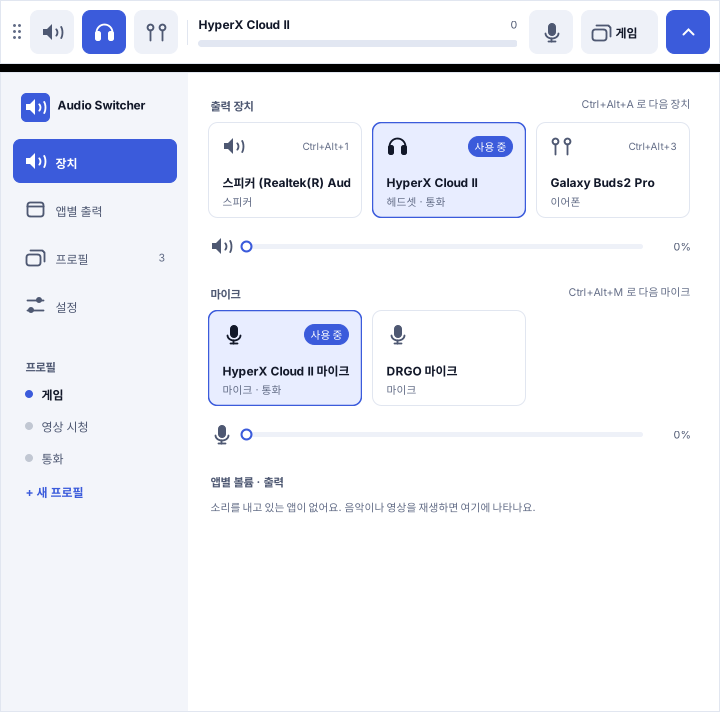
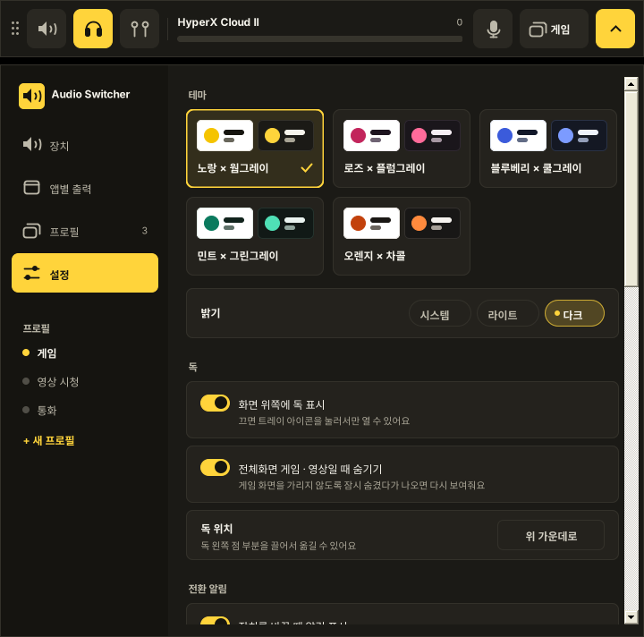

<div align="center">
  
  <h1>Audio Switcher</h1>
  <p>스피커 · 헤드셋 · 이어폰을 클릭 한 번이나 단축키로 전환하는 Windows 트레이 앱</p>
</div>

윈도우 소리 설정을 매번 열지 않고 출력 장치와 마이크를 바꾸기 위해 만들었습니다.
설치 없이 실행되는 단일 exe이고, 외부 라이브러리를 쓰지 않습니다.

화면 위쪽에 얇은 **독**이 붙어 있고, 펼치면 바로 아래로 **워크스페이스**(장치 · 앱별 출력 · 프로필 · 설정)가 열립니다.


## 주요 기능

- **독**: 화면 위쪽에 붙은 막대에서 출력 장치 전환, 볼륨, 마이크 음소거, 프로필을 바로 다룹니다. 왼쪽 점을 끌어 옮길 수 있고, 전체화면 게임 · 영상 중에는 자동으로 숨습니다.
- **테마 5종 × 라이트/다크**: 노랑 · 로즈 · 블루베리 · 민트 · 오렌지 중에 고르고, 밝기는 시스템 설정을 따르거나 직접 고정할 수 있습니다.
- **출력 장치 · 마이크 전환**: 독의 버튼이나 워크스페이스의 장치 카드를 누르면 기본 장치가 바로 바뀝니다.
- **장치 프로필**: '게임', '통화'처럼 출력 장치 · 마이크 · 볼륨을 묶어 저장해 두고, 클릭이나 단축키 한 번으로 한꺼번에 바꿉니다.
- **앱별 출력 장치**: 디스코드는 헤드셋으로, 유튜브는 스피커로 보내는 식으로 앱마다 소리가 나갈 장치를 따로 정합니다. (Windows 10 1803 이상)
- **전환 알림**: 장치를 바꾸면 화면 모서리에 어떤 장치로 바뀌었는지 잠깐 표시합니다. 표시 위치를 고를 수 있고 끌 수도 있습니다.
- **단축키 직접 설정**: 모든 단축키를 원하는 조합으로 바꿀 수 있습니다. 다른 동작이나 다른 프로그램과 겹치면 바로 알려줍니다.
- **볼륨 슬라이더 · 앱별 볼륨**: 아이콘을 클릭하면 음소거되고, 휠을 굴리면 2%씩 조절됩니다.
- **통신 장치 동시 변경**: 디스코드나 게임 보이스가 쓰는 통신 장치까지 함께 바꿉니다.
- **트레이 상주 · 자동 실행**: 트레이 아이콘을 왼쪽 클릭하면 워크스페이스가 열립니다. 독을 꺼 두고 트레이로만 써도 됩니다.






## 단축키 (기본값)

모든 단축키는 설정(⚙) → 단축키에서 바꿀 수 있습니다.

| 단축키 | 동작 |
| --- | --- |
| `Ctrl` + `Alt` + `A` | 다음 출력 장치로 전환 |
| `Ctrl` + `Alt` + `M` | 다음 마이크로 전환 |
| `Ctrl` + `Alt` + `1` ~ `8` | 해당 순번의 출력 장치로 바로 전환 |
| `Ctrl` + `Alt` + `X` | 앱별 볼륨 열기 |
| (지정 안 됨) | 출력 음소거 · 마이크 음소거 · 패널 펼치기/접기 · 각 프로필 적용 |

## 사용법

**테마 바꾸기**: 워크스페이스 → 설정 → 테마에서 색 조합 카드를 누르고, 밝기(시스템 · 라이트 · 다크)를 고릅니다.

**프로필 만들기**: 원하는 장치와 볼륨으로 맞춘 뒤 독의 프로필 버튼 → `지금 설정을 프로필로 저장`을 누릅니다. 세부 설정과 단축키는 워크스페이스의 프로필 탭에서 바꿉니다.

**앱별 출력 장치**: 워크스페이스 장치 탭 아래쪽 앱 목록에서 앱 오른쪽의 장치를 눌러 고릅니다. 지금 소리를 내지 않는 앱은 설정 → 앱별 출력 → `+ 앱 추가`에서 지정할 수 있습니다. 일부 앱은 다시 실행해야 바뀐 장치가 적용됩니다.

**디스코드에 마이크 변경이 반영되지 않는 경우**: 디스코드 설정에서 장치가 특정 기기로 고정되어 있으면 윈도우 기본 장치를 바꿔도 따라오지 않습니다. `사용자 설정 → 음성 및 비디오 → 입력 장치 / 출력 장치`를 **기본값**으로 바꿔두면 이 앱에서 전환할 때 함께 바뀝니다.

## 빌드

Visual Studio나 .NET SDK가 없어도 됩니다. Windows에 기본 포함된 C# 컴파일러를 사용합니다.

```cmd
build.bat
```

`AudioSwitcher.exe` 하나가 만들어집니다. 그대로 실행하면 됩니다.

아이콘을 바꾸고 싶다면 `MakeIcon.cs`의 색을 고친 뒤 아래를 실행해 `app.ico`를 다시 만들고 빌드하면 됩니다.

```cmd
csc MakeIcon.cs && MakeIcon.exe
```

**요구 사항**: Windows 7 이상(앱별 출력 장치는 Windows 10 1803 이상), .NET Framework 4.x (윈도우 기본 설치)

## 소스 구성

| 파일 | 내용 |
| --- | --- |
| `src/Program.cs` | 진입점, 중복 실행 방지 |
| `src/Shell.cs` | 독, 트레이, 전역 단축키, 장치 전환 · 프로필 · 앱별 출력 처리 |
| `src/Workspace.cs` | 펼침 패널 (장치 · 앱별 출력 · 프로필 · 설정 탭) |
| `src/Themes.cs` | 색 조합 5종 × 라이트/다크 팔레트 |
| `src/Dialogs.cs` | 카드 · 탭 항목 · 프로필 이름 입력 창 |
| `src/Toast.cs` | 전환 알림 |
| `src/Theme.cs` | 색 · 글꼴 · 직접 그린 컨트롤들 |
| `src/Audio.cs` | 장치 열거, 기본 장치 변경, 볼륨, 앱별 세션 |
| `src/Routing.cs` | 앱별 출력 장치 지정 |
| `src/Settings.cs` | 설정 저장/불러오기 |
| `src/Interop.cs` | Core Audio COM 인터페이스 정의 |

## 동작 방식

- 장치 열거는 Core Audio의 `IMMDeviceEnumerator`, 기본 장치 변경은 `IPolicyConfig`(비공개 COM 인터페이스)를 사용합니다.
- 볼륨은 `IAudioEndpointVolume`, 앱별 볼륨은 Audio Session API(`IAudioSessionManager2` · `ISimpleAudioVolume`)로 다룹니다.
- 앱별 출력 장치는 Windows 설정의 "앱 볼륨 및 장치 기본 설정"과 같은 내부 API(`Windows.Media.Internal.AudioPolicyConfig`)를 씁니다. 공개 API가 아니라 이후 Windows 업데이트에서 바뀔 수 있습니다.
- 설정은 `%APPDATA%\AudioSwitcher\settings.ini`에 저장됩니다.
- UI는 WinForms이지만 기본 컨트롤이 다크 배경에서 잘 보이지 않아 카드 · 슬라이더 · 스위치 · 드롭다운 · 버튼을 직접 그렸습니다.
- 독은 1초마다 앞에 있는 창이 모니터 전체를 덮는지 확인해, 전체화면이면 잠시 숨깁니다.
- 장치 목록과 볼륨은 2초 간격으로 갱신되므로, 다른 프로그램에서 바꾼 내용도 곧 반영됩니다.

## 라이선스

개인용으로 만든 프로젝트입니다. 자유롭게 가져다 쓰셔도 됩니다.
