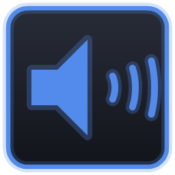
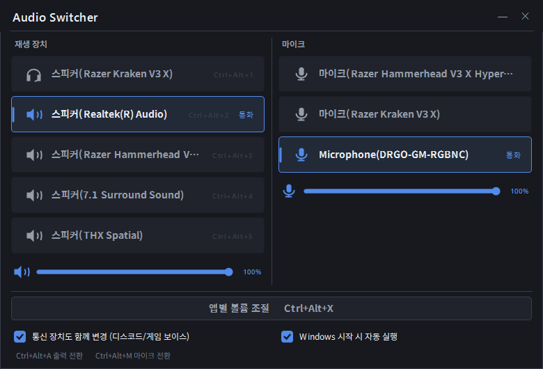
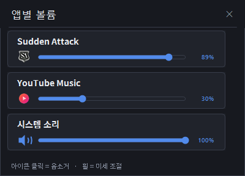

<div align="center">
  
  <h1>Audio Switcher</h1>
  <p>스피커 · 헤드셋 · 이어폰을 클릭 한 번이나 단축키로 전환하는 Windows 트레이 앱</p>
</div>

윈도우 소리 설정을 매번 열지 않고 출력 장치와 마이크를 바꾸기 위해 만들었습니다.
설치 없이 실행되는 단일 exe이고, 외부 라이브러리를 쓰지 않습니다.



## 주요 기능

- **출력 장치 · 마이크 전환** — 카드를 클릭하면 기본 장치가 바로 바뀝니다. 좌우 2단으로 나뉘어 있어 한눈에 들어옵니다.
- **전역 단축키** — 다른 프로그램이 떠 있어도, 게임 중에도 동작합니다.
- **볼륨 슬라이더** — 출력과 마이크 각각의 볼륨을 조절합니다. 아이콘을 클릭하면 음소거, 휠을 굴리면 2%씩 미세 조절됩니다.
- **앱별 볼륨 조절** — 소리를 내는 앱마다 볼륨을 따로 조절합니다. 실행 파일에서 아이콘과 이름을 가져오고, 크롬처럼 프로세스를 여러 개 쓰는 앱은 하나로 묶어서 다룹니다.
- **통신 장치 동시 변경** — 디스코드나 게임 보이스가 쓰는 통신 장치까지 함께 바꿉니다.
- **트레이 상주** — 닫기(✕)를 누르면 트레이로 들어갑니다. 트레이 아이콘 우클릭으로도 전환할 수 있습니다.
- **시작 시 자동 실행** — 체크 한 번으로 등록됩니다.



## 단축키

| 단축키 | 동작 |
| --- | --- |
| `Ctrl` + `Alt` + `A` | 다음 출력 장치로 전환 |
| `Ctrl` + `Alt` + `M` | 다음 마이크로 전환 |
| `Ctrl` + `Alt` + `1` ~ `8` | 해당 순번의 출력 장치로 바로 전환 |
| `Ctrl` + `Alt` + `X` | 앱별 볼륨 창 열기 |

## 빌드

Visual Studio나 .NET SDK가 없어도 됩니다. Windows에 기본 포함된 C# 컴파일러를 사용합니다.

```cmd
build.bat
```

`AudioSwitcher.exe` 하나가 만들어집니다. 그대로 실행하면 됩니다.

아이콘을 바꾸고 싶다면 `MakeIcon.cs`의 색을 고친 뒤 아래를 실행해 `app.ico`를 다시 만들고 빌드하면 됩니다.

```cmd
csc MakeIcon.cs && MakeIcon.exe
```

**요구 사항** — Windows 7 이상(Windows 11에서 개발·테스트), .NET Framework 4.x (윈도우 기본 설치)

## 사용 팁

**디스코드에 마이크 변경이 반영되지 않는 경우** — 디스코드 설정에서 장치가 특정 기기로 고정되어 있으면 윈도우 기본 장치를 바꿔도 따라오지 않습니다. `사용자 설정 → 음성 및 비디오 → 입력 장치 / 출력 장치`를 **기본값**으로 바꿔두면 이 앱에서 전환할 때 함께 바뀝니다.

## 동작 방식

- 장치 열거는 Core Audio의 `IMMDeviceEnumerator`, 기본 장치 변경은 `IPolicyConfig`(비공개 COM 인터페이스)를 사용합니다.
- 볼륨은 `IAudioEndpointVolume`, 앱별 볼륨은 Audio Session API(`IAudioSessionManager2` · `ISimpleAudioVolume`)로 다룹니다.
- UI는 WinForms이지만 기본 컨트롤이 다크 배경에서 잘 보이지 않아 슬라이더 · 체크박스 · 버튼을 직접 그렸습니다.
- 장치 목록과 볼륨은 2초 간격으로 갱신되므로, 다른 프로그램에서 바꾼 내용도 곧 반영됩니다.

## 라이선스

개인용으로 만든 프로젝트입니다. 자유롭게 가져다 쓰셔도 됩니다.
